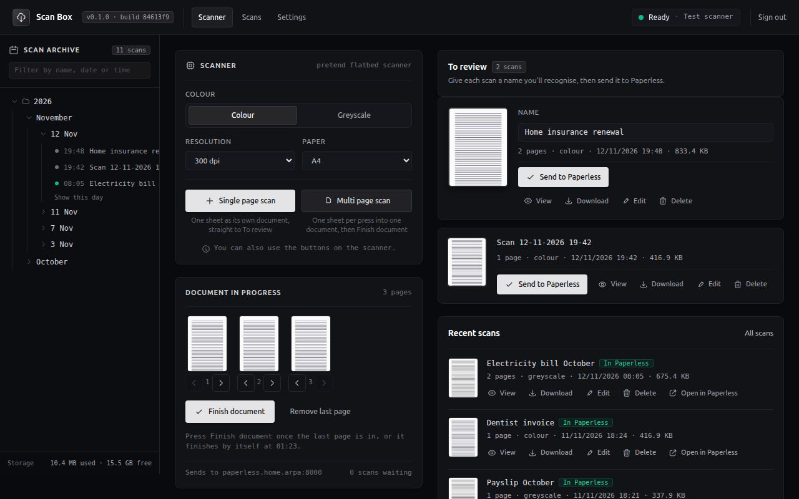
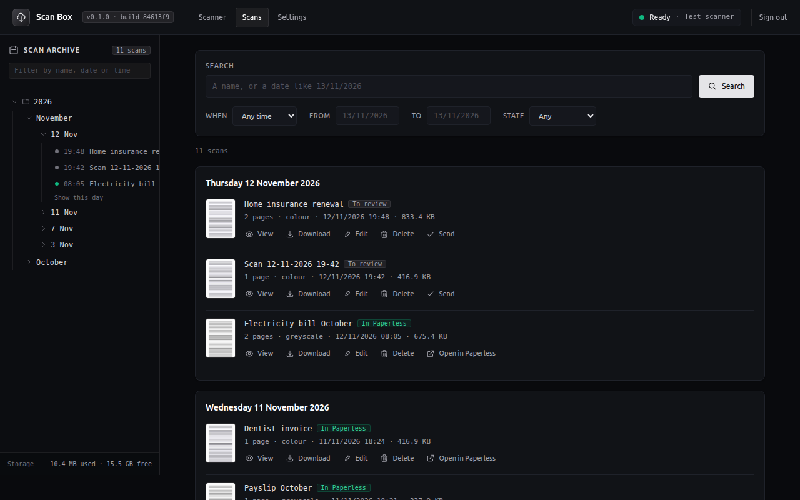
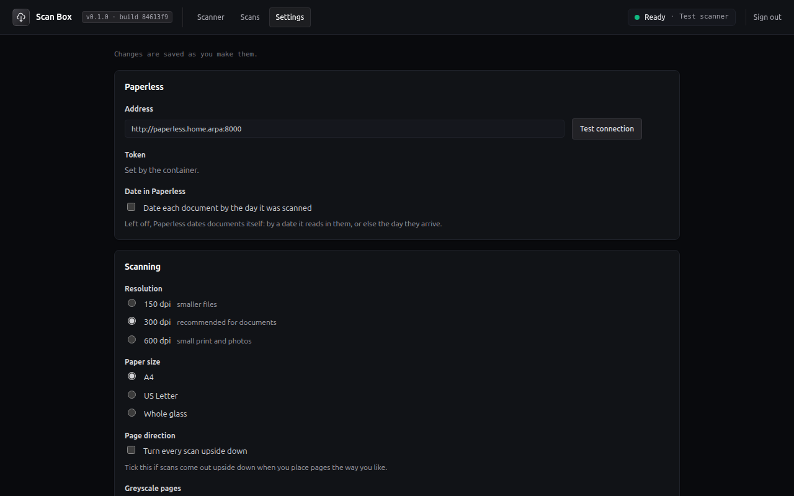
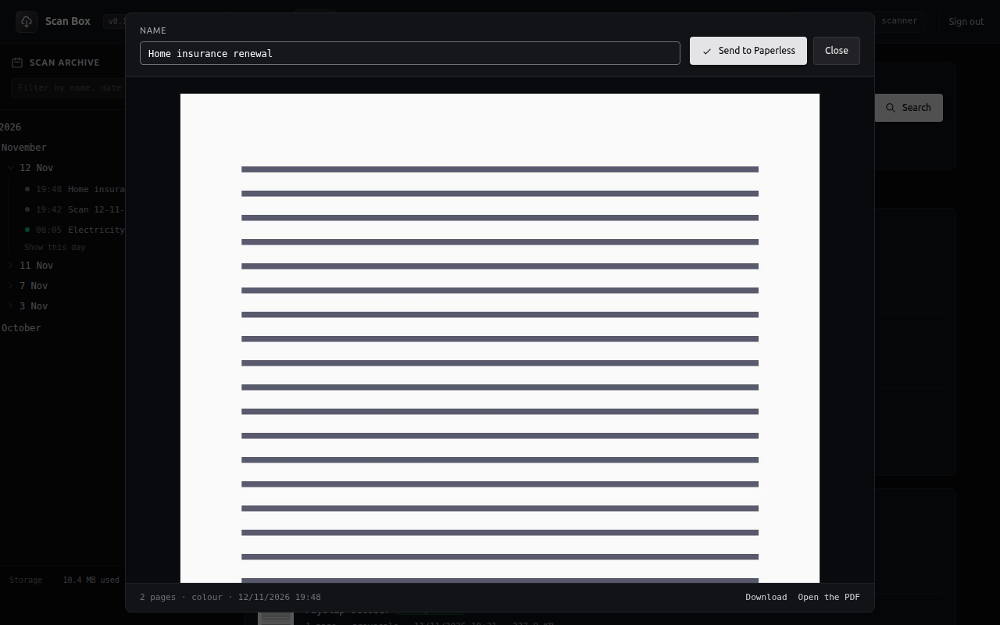
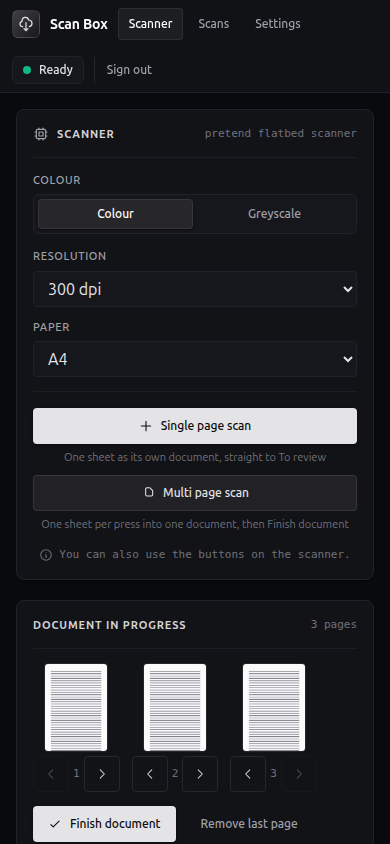

# Scan Box

Scan from a USB scanner straight into [Paperless-ngx](https://docs.paperless-ngx.com/),
from one calm web page. Press a button on the scanner, or on the page. Check the
scan, give it a name you'll recognise, and send it.



## What it does

- **One page for scanning,** one for settings.
- **The scanner's own buttons work.** Each one can be set to a single page or
  a multi page scan, in colour or greyscale, or to finish a document.
- **Single page scan** makes a document of one sheet at once. **Multi page
  scan** adds a sheet per press to one document, colour and greyscale mixed:
  the arrows under each page put them in another order, "Remove last page"
  fixes a bad scan, and the document finishes by itself 2 minutes after its
  last page, unless **Finish document** lands it sooner.
- **To review:** each scan waits until you name it and press **Send to
  Paperless**. Your name becomes the document's title. You can switch this off
  to send scans straight away.
- **See before you name:** each page opens large inside the page, with the name
  field and Send right beside it. No PDF reader needed.
- **View, Download, Edit and Delete on every scan,** wherever it is listed:
  to review, recent, on the Scans page. Download gives a PDF named after the
  scan, before or after it goes to Paperless. Edit renames it; once it is in
  Paperless, only Scan Box's copy changes and Paperless keeps its title.
  Delete asks first, and says whether Paperless keeps a copy.
- **An archive beside the page:** every scan by year and month, the month on
  show by day, with how many each holds and a filter. Another month opens with
  a click, so the page stays quick however many scans are kept.
- **Only real facts on screen:** the scanner's model and driver, SANE's
  version, the version Paperless reports and the build of Scan Box itself are
  all read live, never typed in.
- **Scans page:** search by name or by date ("11/11/2026", "november",
  "monday"), filter by period or state, or open a month to see its scans by
  day.
- **Dates your way:** time zone, date style and time style are chosen in
  Settings, each shown as an example. The defaults are European: 11/11/2026
  and 24-hour time, in UTC, or in the time zone `TZ` names in `.env`. Typed
  dates are never read month first. Scans are kept in date folders:
  `scans/2026/11-2026/11-11-2026/`.
- **Nothing is lost:** scans wait on disk until Paperless accepts them. An
  accepted scan is "In Paperless" only once Paperless says it stored it, with a
  link to the document it made; if Paperless doesn't store it, or refuses the
  file, the scan is kept and marked "Failed" with Paperless's reason, Retry and
  Delete, and the scans behind it go on. An upload that came to nothing is
  tried again after a minute, then after pauses that double up to an hour;
  **Send now** skips the pause. A refused token or a wrong address stops the
  sending, with one message, until it is fixed. Scans in Paperless are kept,
  unless a limit is chosen in Settings, counted from the day Paperless
  confirmed them.
- **Room on the box:** scanning stops, before the scanner moves, while less
  than the chosen space (200 MB at first) is free, and the status line warns
  from five times that. A document holds up to 200 pages.
- **Settings are made in the page.** The container's environment holds only
  the secrets.
- **Setup checker:** Settings shows what the container is missing, with lines
  to copy.

**What is supported:** tried with the Canon CanoScan LiDE 400 on an x86-64 box
with Ubuntu 24.04 and Docker 29, sending to Paperless-ngx 3. The image is built
for amd64 only; arm64 (a Raspberry Pi) is not built yet. It carries only SANE's
Canon `pixma` driver, built from SANE 1.4.0, which covers Canon's PIXMA,
imageCLASS and CanoScan LiDE models. The front buttons are known for the LiDE
300 and LiDE 400. Other makes would need their SANE driver added to the
`BACKENDS` line in the `Dockerfile`, and their own buttons.

## Screenshots

| Scans                                                                   | Settings                                                        |
| ----------------------------------------------------------------------- | --------------------------------------------------------------- |
|  |  |

| A scan, large, with its name and Send                                    | On a phone                                                     |
| ------------------------------------------------------------------------ | -------------------------------------------------------------- |
|  |  |

The screenshots come from made-up scans on a fresh instance, with the pretend
scanner (`-fake-scanner`) and a stand-in for Paperless.

## Set up

Scan Box is one container, `ghcr.io/aiulian25/scanbox`, on the **Linux amd64**
box the scanner is plugged into, with Docker Engine and the Compose plugin.

1. Download [`compose.yaml`](compose.yaml) and [`.env.example`](.env.example)
   into a new folder, saving the second as `.env`:
   ```sh
   mkdir scanbox && cd scanbox
   curl -fLO https://raw.githubusercontent.com/aiulian25/scanbox/main/compose.yaml
   curl -fL -o .env https://raw.githubusercontent.com/aiulian25/scanbox/main/.env.example
   ```
2. Put these files next to `compose.yaml`:
   - `paperless-token.txt`: the API token of a Paperless user that may add
     documents and view tasks: in Paperless, under Users & Groups, tick Add for
     Document and View for PaperlessTask. Nothing more is safest. Viewing tasks
     is how Scan Box learns that Paperless stored a scan, and the number of the
     document it made.
   - `scanbox-password.txt`: the password for the page. Until it has one it
     can read, the page stays locked and shows only what to add.

   Scan Box runs as user 10001 inside the container, so give both files to
   that user:
   ```sh
   sudo chown 10001 paperless-token.txt scanbox-password.txt
   sudo chmod 400 paperless-token.txt scanbox-password.txt
   ```
3. Fill in the two values under "Required" in `.env`. Without them, `docker
   compose up` stops and says which is missing. The rest of `.env` is
   optional: the time zone a new install starts in, and the settings for a
   reverse proxy.
   - `SCANBOX_ADDRESS`: the one address of the box the page is published on.
     The page travels unencrypted on it, the password included. On a network
     you don't trust, publish on `127.0.0.1` and put a TLS proxy in front (see
     [Reaching the page safely](#reaching-the-page-safely)).
   - `SCANNER_GID`: the group of the scanner's device file. Scan Box opens the
     scanner through it, and no other USB device of the box. With the scanner
     plugged in:
     ```sh
     lsusb -d 04a9:                                # Canon: note the bus and device numbers
     stat -c '%g %G %a' /dev/bus/usb/001/002       # that bus and device
     ```
     On Ubuntu this prints, for example, `7 lp 664`: the group is 7. If it
     prints group `0 root`, give the scanner a group first, as below.
4. Make the volume the settings and scans live in, once. Compose never deletes
   it, not even with `docker compose down -v`: only `docker volume rm` does.
   ```sh
   docker volume create scanbox_scanbox-data
   ```
5. Start it, then open `http://<that address>:28761`:
   ```sh
   docker compose up -d
   ```
6. Under Settings, enter your Paperless address and press **Test connection**.

**The Paperless address** is the one your browser shows for Paperless, without
a user name, password, `?` or `#` in it: Scan Box signs in with the token,
which goes with every request. Over the internet it must start with `https`.
`http` is taken only for an address on your own network: a private, loopback or
Tailscale (`100.64.0.0/10`) address, a one-word name, or a name ending in
`.local`, `.lan`, `.home.arpa`, `.internal` or `.localhost`.

**Paperless with a certificate of your own,** from a home certificate
authority or self-signed, needs that certificate as `paperless-ca.pem` next to
`compose.yaml`, readable by everyone (`chmod 644`; it isn't secret), and these
lines added to `compose.yaml`. The certificates the image already trusts stay
trusted. Don't look for a way to skip the check instead: the token would go to
whoever answers.
```yaml
services:
  scanbox:
    environment:
      SSL_CERT_FILE: /run/secrets/paperless_ca
    secrets:
      - paperless_ca
secrets:
  paperless_ca:
    file: ./paperless-ca.pem
```

**Dates in Paperless:** Paperless dates each document itself, by a date it
reads in it, or else by the day it arrives. To date every scan by the day it
was scanned instead, tick **Date each document by the day it was scanned**
under Settings, Paperless.

**A scanner whose device file belongs to group root** needs one rule on the
box, which gives it a group (here `lp`) whenever it is plugged in. For the
LiDE 400 (`04a9:1912`):
```sh
echo 'SUBSYSTEM=="usb", ATTR{idVendor}=="04a9", ATTR{idProduct}=="1912", GROUP="lp", MODE="0660"' | sudo tee /etc/udev/rules.d/60-scanbox.rules
sudo udevadm control --reload-rules
sudo udevadm trigger --action=change --subsystem-match=usb --attr-match=idVendor=04a9 --attr-match=idProduct=1912
```
Never `chmod` the device file, nor a rule with `MODE="0666"`: the first is lost
at the next plug-in, the second opens the scanner to every user of the box.

Scan Box uploads every file as `scanbox-<number>.pdf` with your name as the title. A
Paperless workflow can therefore match all its scans with the filename filter
`scanbox-*`, for example to add a tag or set the owner.

## What the container needs

| Need | Why |
|---|---|
| `/dev/bus/usb:/dev/bus/usb:ro` under `volumes` and `device_cgroup_rules: ["c 189:* rw"]` | to reach the scanner, also when it is plugged in, or back in, after the start. Not under `devices`: that copies only the devices there at the start |
| `group_add: ["${SCANNER_GID}"]` | to open the scanner, and only the scanner, as user 10001 |
| a volume at `/data` | settings, the open document and waiting scans |
| `PAPERLESS_TOKEN_FILE` (or `PAPERLESS_TOKEN`) | the Paperless token |
| `SCANBOX_PASSWORD_FILE` (or `SCANBOX_PASSWORD`) | the page password. Without one, or with a file that is missing, empty or unreadable, the page stays locked and says what to do; the scanner's own buttons keep working |

Three more settings are there for the boxes that need them, each a line in
`.env`:

| Setting | When |
|---|---|
| `SCANBOX_ALLOW_NO_PASSWORD=yes` | to use the page without a password. Everyone who can reach the box can then scan, read the scans and change the settings, so only on a network where you trust everyone. It never stands in for a password that is set but can't be read |
| `SCANBOX_HOSTS=scan.example.org` | when the page is reached under a name with a dot in it, as behind a reverse proxy. Several names are separated by commas |
| `SCANBOX_TRUSTED_PROXY=172.18.0.2` | behind a reverse proxy: its address, or a range such as `172.18.0.0/16`. Its `X-Forwarded-For` and `X-Forwarded-Proto` are believed, so a lockout after wrong passwords applies to one client, and the session cookie is marked secure over https. Nobody else's are |

The page answers to addresses (`192.168.10.20`), one-word names (`mybox`) and
names ending in `.local`, `.lan`, `.home.arpa`, `.internal` or `.localhost`.
Under any other name it answers "421" and names `SCANBOX_HOSTS`. That keeps a
website elsewhere from pointing a name of its own at the box and using the page
through your browser.

It runs as user 10001, with a read-only file system, no Linux capabilities and
no privilege escalation, and nothing needs installing on the host, except the
rule above where the scanner has no group. The image holds only the program,
the libraries it and the scanner driver load, SANE's settings and the CA
certificates: no shell, package manager or setuid program, 22 MB in all. Its
log is rotated by `compose.yaml` itself, at 10 MB with three files kept, so it
never fills the disk, whatever the box's own Docker settings say.

## Reaching the page safely

Scan Box speaks plain HTTP. To use it beyond a home network you trust, put a
reverse proxy that speaks HTTPS in front of it:

- Publish the page on `127.0.0.1` when the proxy runs on the same box, or on
  the box's network address when it runs elsewhere, and let only the proxy
  reach it.
- The proxy must pass the `Host` header unchanged, set `X-Forwarded-For` and
  `X-Forwarded-Proto`, and not buffer `/live`, which streams. For nginx:
  `proxy_set_header Host $host; proxy_buffering off; proxy_read_timeout 1h;`.
- Put the proxy's name in `SCANBOX_HOSTS` and its address in
  `SCANBOX_TRUSTED_PROXY`.

Every page tells the browser to load nothing from other sites and not to be
shown inside another site's frame. **Sign out** ends every session, on every
device: a copied cookie stops working too.

**On a box that forwards traffic,** such as a Tailscale exit node or a router,
set `"ip-forward-no-drop": true` in `/etc/docker/daemon.json` before installing
Docker. Otherwise Docker blocks forwarded traffic.

## Back up and restore

Everything Scan Box keeps is in the volume `scanbox_scanbox-data`, at `/data`
in the container. `compose.yaml` marks it external, so Compose never deletes
it: not `docker compose down`, not `down -v`. It goes only with `docker volume
rm scanbox_scanbox-data`.

| In `/data` | What it is |
|---|---|
| `settings.json` | the settings made in the page |
| `session.key`, `session.generation` | what sign-ins are signed with. A secret: keep backups private |
| `document/` | the pages of a document not finished yet |
| `scans/` | every scan by year, month and day: its PDF, its pictures and `info.json` |

The scans are your documents, so keep the backup as private as they are.

**Back up,** with the page stopped for a moment so nothing changes meanwhile.
From the folder that holds `compose.yaml`:
```sh
docker compose stop
docker run --rm -v scanbox_scanbox-data:/data:ro -v "$PWD":/backup debian:trixie-slim tar -C /data -czf /backup/scanbox-data.tar.gz .
docker compose start
```

**Check a backup** by restoring it into a second volume and counting the scans
in it; the count should match the Scans page:
```sh
docker volume create scanbox-restore-check
docker run --rm -v scanbox-restore-check:/data -v "$PWD":/backup debian:trixie-slim tar -C /data -xzf /backup/scanbox-data.tar.gz
docker run --rm -v scanbox-restore-check:/data:ro debian:trixie-slim sh -c 'find /data/scans -name info.json | wc -l'
docker volume rm scanbox-restore-check
```

**Restore** into the real volume, which replaces what it holds:
```sh
docker compose down
docker volume rm scanbox_scanbox-data
docker volume create scanbox_scanbox-data
docker run --rm -v scanbox_scanbox-data:/data -v "$PWD":/backup debian:trixie-slim tar -C /data -xzf /backup/scanbox-data.tar.gz
docker compose up -d
```
The files keep their owner, user 10001. Scans that were waiting, or accepted
but not yet confirmed, go on from where they were; an upload that was under way
is looked for in Paperless before it is sent again.

## Upgrade and roll back

`compose.yaml` runs `ghcr.io/aiulian25/scanbox:0`, the newest 0.x release.
Scan Box never upgrades by itself. To upgrade, back up as above, then, from the
folder that holds `compose.yaml`:
```sh
docker compose pull
docker compose up -d
```
To stay on one release, or go back to one, name it in `.env`, then run
`docker compose up -d`. Delete the line to follow the newest 0.x again:
```sh
SCANBOX_IMAGE=ghcr.io/aiulian25/scanbox:0.1.0
```
The page shows the release and build it runs. What each release changed is in
its tag's message, under [Tags](https://github.com/aiulian25/scanbox/tags).

Settings carry a version number and an older Scan Box ignores what it doesn't
know, so going back keeps them. A change in how scans are laid out on disk
would need the backup instead; the release would say so.

## When something is wrong

`docker logs scanbox` shows what happened: every upload's outcome, every
sign-in and wrong password, every change made in the page. It never shows a
password or the token. `docker inspect --format '{{.State.Health.Status}}'
scanbox` says whether both of Scan Box's loops, the scanner's and the
uploads', are moving.

| The page says | What to do |
|---|---|
| This page is locked | It has no password it can use. The notice says what is missing, with the lines to add |
| Scanner not found | Check the cable and that the scanner is on; it is found again within seconds. If not, check `SCANNER_GID` and the `/dev/bus/usb` mount (Settings, Container setup) |
| The scanner is busy | A page is being scanned and one more is already waiting its turn: press again when it stops. If nothing is scanning, another program is using the scanner; close that, then press again |
| The scanner doesn't offer this setting | Choose another resolution or paper size |
| The scan took longer than … and was stopped | The scanner stopped answering; it is looked for again. If the driver never returns, Scan Box stops and Docker starts it again |
| Space is running out | Delete old scans in Scans, free space on the box, or lower "Keep free on the box" in Settings |
| Paperless can't be reached | Check the address under Settings, and that Paperless is up; waiting scans go out by themselves |
| Paperless's certificate isn't trusted | Paperless uses a certificate of its own: give Scan Box the authority that signed it, as in [Set up](#set-up) under "Paperless with a certificate of your own" |
| Paperless refused the token; nothing is sent until that is fixed | Make a new token for the Paperless user and put it in `paperless-token.txt`, then `docker compose up -d` |
| Paperless can't confirm … scans | Give the token's user View for PaperlessTask in Paperless |
| Failed, with a reason | Paperless didn't store the scan. Fix what the reason says, then **Retry**, or **Delete** |
| Too many wrong passwords | Wait a minute; only that client is locked out |
| Scan Box doesn't answer to the name … (421) | Add that name to `SCANBOX_HOSTS` |
| Scan Box couldn't read settings.json … (Settings) | The settings were damaged and are back to the defaults: set them again. The old file is kept in the volume as `settings.json.damaged` |
| … scans couldn't be read and aren't listed (under the archive) | Their files are kept in the folders it names, in the volume; the log says what is wrong. Copy a PDF out with `docker cp scanbox:/data/<folder>/document.pdf .` |

If the container stops at once, its log says why. "Scan Box runs as user
10001, which may not write /data" comes with the one command that fixes it.

**Looking inside:** the image has no shell, so `docker exec` has nothing to
run. A throwaway container that shares Scan Box's network and sees its files,
read-only, has one:
```sh
docker run --rm -it --network container:scanbox --volumes-from scanbox:ro debian:trixie-slim bash
```
There, `/data` is Scan Box's data, and the network is the one Scan Box reaches
Paperless through.

## Remove

From the folder that holds `compose.yaml`:
```sh
docker compose down
```
That stops and removes the container and keeps the volume with every scan, so
`docker compose up -d` brings it all back; so does `docker compose down -v`,
which leaves this volume alone. To delete the scans and settings too, for good:
```sh
docker volume rm scanbox_scanbox-data
```
Then, in Paperless's admin (`/admin/`, Auth Token, Tokens), delete the token,
and remove `paperless-token.txt`, `scanbox-password.txt` and `.env`. If you added
the udev rule, remove `/etc/udev/rules.d/60-scanbox.rules`.

## Development

```sh
go test ./...
SCANBOX_ALLOW_NO_PASSWORD=yes go run ./cmd/scanbox -data ./dev-data -listen 127.0.0.1:28761 -fake-scanner
```

`-fake-scanner` uses a pretend scanner, so the whole page can be tried without
hardware. `SCANBOX_ALLOW_NO_PASSWORD=yes` serves it without a password; leave
it out to see the locked page. The real scanner driver needs `libsane-dev` and the `sane` build tag;
the Docker image is built that way. Its build also runs the driver code against
SANE's `test` backend, which stands in for a scanner and stays out of the
image.

**Your own image:** `deploy/build.sh` builds it here and tags it with its build
ID, which the page also shows, and its image's ID, for example
`scanbox:1a2b3c4-5d6e7f8`, so one build never overwrites another.
`deploy/to-box.sh mybox scanbox:1a2b3c4-5d6e7f8` copies it over SSH, with
`compose.yaml`, to `~/scanbox` on that box, names it in `SCANBOX_IMAGE` in the
box's `.env`, starts it, waits until Docker calls it healthy, and prints the one
command that goes back to the image that ran before.

The PDF writer and the date parser have fuzz tests; run one for a while with,
for example, `go test -run '^$' -fuzz FuzzWriteKeepsItsCrossReference -fuzztime 1m ./internal/pdf/`.

`ci/check.sh` runs every check a change must pass, in order: formatting, vet,
the tests under the race detector, staticcheck, govulncheck, the image build,
Trivy on the image and gitleaks on the files. The Dockerfile pins its three
base images by digest; look up newer ones about once a month with `docker
buildx imagetools inspect <image>`, put them in, and run the checks.
